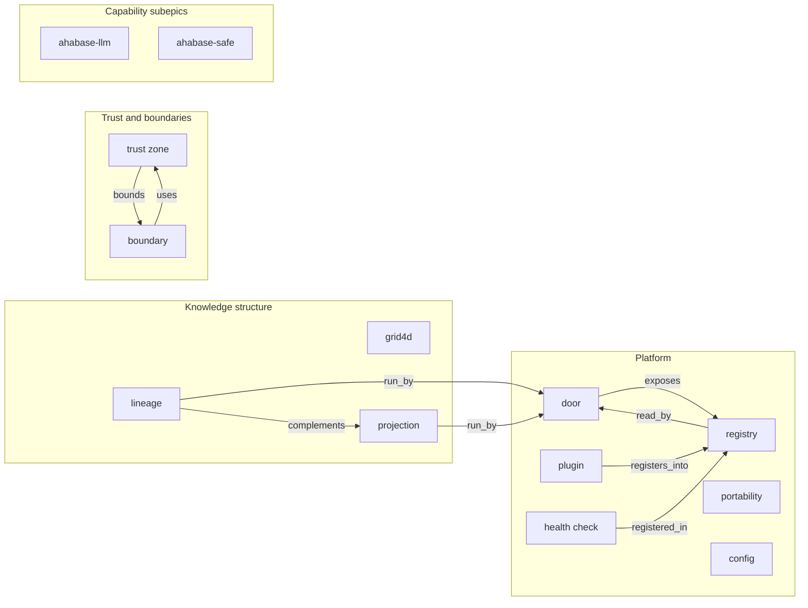

# ahabase Ontology

> The open foundation of ahabase: the concepts of a tool for building a knowledge base in which everyone shares their knowledge under control or protects it - the base that methods such as evolucean extend.

**Status:** accepted by the Human (2026-10-25, [AHA-0004](AHA-0004))

## Purpose

The premise (Human, 2026-10-25): the value of knowledge grows and must be protectable, while the cost of work - the creation of software included - falls. ahabase is therefore the tool to build a knowledge base where one's knowledge can be shared under control or protected. Its mechanism is open, because open code builds trust, adoption and contributions and a closed tool is cheap to rebuild anyway; what is protected is knowledge.

This ontology is the **base** of the architecture. A method - evolucean is the first - is built on it and extends its concepts; the base never depends on a method. The same direction holds for code (a method imports the package) and for knowledge (a method's documents link to these, never the reverse).

| | ahabase - the base (open) | a method, e.g. evolucean (protected) |
|---|---|---|
| What | the mechanism: structure that software can verify | the know-how: how to work well |
| Contents | primitives, the knowledge format, trust and boundaries, the safe, the doors and the plugin contract, the basis of collaboration | shaping, gradients, measurement, karma, tuned patterns and playbooks, the coordination of review seats |
| Zone | 0 Public | 3 Core and inward |
| Value | trust, adoption, a standard | the advantage of the method, its community and history |

## Taxonomy

The skeleton of the whole Epic. Layers 2 and 3 are defined now, because the next steps build them; layers 0 and 1 and the basis of collaboration are named here and defined when they are built (the move of the knowledge format is planned in the architecture blueprint).

| Layer | Concepts | State |
|---|---|---|
| 0 Primitives | Concept, Attribute, Relation, is_a, Ontology, Language | named - defined with layer 1 |
| 1 Knowledge structure (the grid4d format) | Epic, SubEpic, Repository, Instance, Knowledge, Knowledge Class, Scope (ontology, implementation, story), Document Pattern, Story, Requirement, Test, Issue, Idea, Artifact, Identity, Epic Inheritance, Plugged-in Epic, Knowledge Map (the record of what a story used; its evaluation is a method's), Lineage, Projection | named - defined when the format moves; Lineage and Projection defined first, because the transparency core verifies them (AHA-0009) |
| 2 Trust and boundaries | Trust Zone, Boundary (the safe's concepts - Safe Value through Scan Finding - are the ahabase-safe subepic's vocabulary, [00-ahabase-safe-ontology-index](00-ahabase-safe-ontology-index)) | defined - implementation state per concept (Agent Guard, Output Watch and Scan Finding planned) |
| 3 Platform | Door, Registry, Plugin, Health Check, Portability, Config | defined - implementation state per concept |
| Collaboration (basis) | Instance, Sharing, Review, Verdict | named - defined with the collaboration story |

## Vocabulary

### Knowledge structure

- [Grid4d](ontology-grid4d-blueprint) - the knowledge-tree format: folders, a self-registering identity, naming, structure, links - one home per rule
- [Lineage](ontology-lineage-blueprint) - the declared path from a concept to its code and back, and the check that both still agree
- [Projection](ontology-projection-blueprint) - a view generated from the documents, never written by hand, the same bytes every time

### Trust and boundaries

- [Trust Zone](ontology-trust-zone-blueprint) - how far shared knowledge may travel, six zones by receiver distance
- [Boundary](ontology-boundary-blueprint) - the line between a person's personal side and what they share

The safe's concepts - Safe Value through Scan Finding - moved to the ahabase-safe subepic (2026-10-31, AHA-0018); their vocabulary and map live in [00-ahabase-safe-ontology-index](00-ahabase-safe-ontology-index).

### Platform

- [Door](ontology-door-blueprint) - a way in: the CLI, the MCP server, the Claude Code plugin
- [Registry](ontology-registry-blueprint) - the one list of commands, checks and tools behind every door
- [Plugin](ontology-plugin-blueprint) - a distribution that registers into the registry; a method is a plugin
- [Health Check](ontology-health-check-blueprint) - a named check that `doctor` runs
- [Portability](ontology-portability-blueprint) - one codebase on the OSes its users run: library, then dispatch, then own code; both variants in the same story
- [Config](ontology-config-blueprint) - where everything lives: the workspace, each epic's settings and data, the machine id - the first graduated capability (AHA-0021)

## Relations

- The [Lineage](ontology-lineage-blueprint) joins every concept of this ontology to the implementation blueprint and the code that implement it; a [Projection](ontology-projection-blueprint) such as the ontology map below shows the structure, generated from the documents.
- A [Boundary](ontology-boundary-blueprint) separates the personal side of a person from what they share; the [Trust Zone](ontology-trust-zone-blueprint) of shared knowledge says how far it travels.
- The safe's concepts serve this layer's structure: a [Safe Value](ontology-safe-value-blueprint) belongs to the innermost zone (its value lives in a [Store](ontology-store-blueprint), configuration holds a [Reference](ontology-reference-blueprint)), and the [Agent Guard](ontology-agent-guard-blueprint) keeps the [Boundary](ontology-boundary-blueprint) against agent reach - their vocabulary and relations live in [00-ahabase-safe-ontology-index](00-ahabase-safe-ontology-index).
- A [Door](ontology-door-blueprint) exposes the [Registry](ontology-registry-blueprint); a [Plugin](ontology-plugin-blueprint) registers commands and [Health Checks](ontology-health-check-blueprint) into it; a method is a plugin; every part of the base is [Portable](ontology-portability-blueprint) - one codebase on the OSes its users run.
- A method's concept extends a base concept: the base blueprint defines it, its basic attributes and relations; the method's blueprint keeps its own name, states which base concept it extends and adds its know-how (a story of the base has requirements and tests; a method's story adds gradients and karma).

## Constraints

- **The boundary criterion** (Human, 2026-10-25) - a concept belongs to the base when it describes structure and can be verified deterministically: what a thing is, what it looks like, how it is checked. It belongs to a method when it describes how to work well, so that publishing it would hand over the method's advantage. Applying the criterion is a reviewed judgment: every concept blueprint states its **Placement** with the reason, a test checks that the line exists, and review checks the reason.
- **Never back** (Human, 2026-10-25) - what enters the open zone stays open. The base takes in less, but for good: an open project that later closes what was open loses its community's trust.
- **Collaboration in three layers** (Human, 2026-10-25) - the basis of collaboration of individuals and small teams (instances, sharing by zone, review, boundaries) is open, because it drives adoption; the collaboration of organizations (central policies, corporate identity, audit, compliance) is a paid layer; tuned playbooks and the coordination of review seats are a method's know-how.
- **Direction** - a method's documents link to the base; the base names no document of a method. The Epic header still says that ahabase inherits evolucean, because the story workflow lives in evolucean's tooling: a known exception until the knowledge format and the story workflow move into the package; then the direction turns (the steps and the gate are in the architecture blueprint).
- **Minimal** - every concept of the base is a public contract; it is defined when the next steps build on it, not in advance, and its **State** says whether it is implemented, implemented in part or planned.

## Ontology map

Generated by `ahabase ontology graph` - never edit by hand.

<!-- ontology-map:begin -->

<!-- ontology-map:end -->

## Related

- [AHABASE](AHABASE) - the Epic
- [implementation-ahabase-architecture-blueprint](implementation-ahabase-architecture-blueprint) - base and method in code, the move and the turn of inheritance
- [implementation-ahabase-safe-blueprint](implementation-ahabase-safe-blueprint) - the safe, implementing layer 2
- [safe-first-public-capability](safe-first-public-capability) - why the safe comes first
