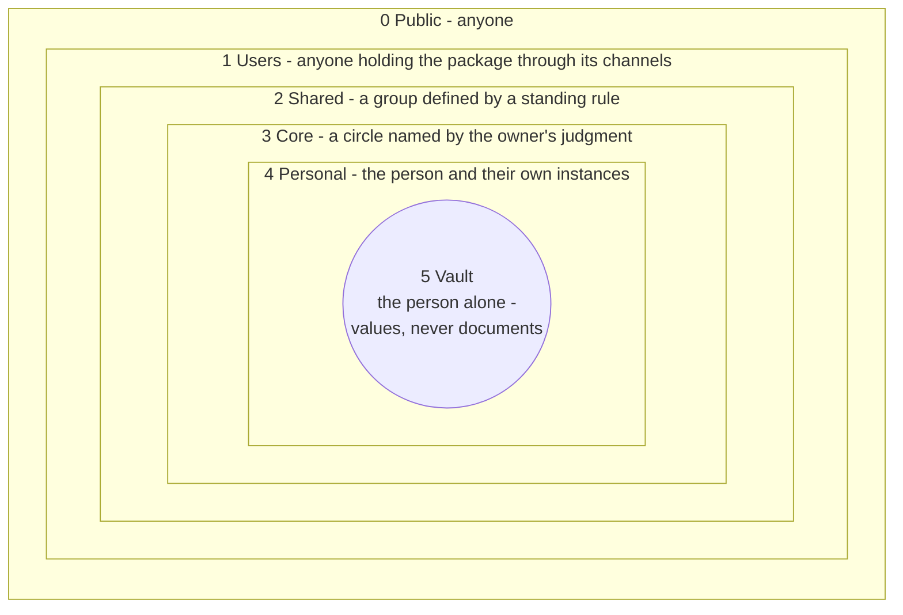

# Trust Zone Blueprint

> How far shared knowledge may travel: six zones by receiver distance, from anyone (0 Public) to the person alone with their values (5 Vault).

**Ontology:** [00-ahabase-ontology-index](00-ahabase-ontology-index) → Trust and boundaries → Trust Zone
**Placement:** base - the zones are a structure every document is classified by, and a check can verify a document's zone
**State:** implemented in part - the open-zone link containment check (AHA-0016); the artifact containment gate over the built wheel and sdist (AHA-0029); zone-scoped sharing is planned; amended to six zones (AHA-0018)

## Overview

**Trust Zone** = the distance of trust at which knowledge may travel, measured in receivers. It answers "who may see this?" The receivers are persons and machines alike: an LLM agent that reads a document is a receiver, so the ladder admits machine receivers - what matters is how many receivers stand between the content and anyone. Within each zone, as much is shared as is safe at that distance - as a person shares differently with strangers, acquaintances, friends and family. AI makes extracting knowledge from anything published nearly free, so sharing is bound to trust, and trust runs both ways: whoever makes knowledge must be able to trust whoever receives it, and whoever uses a tool must be able to trust the tool that reads their knowledge.

The chain of receivers, from the closest out: the person alone (**5 Vault**) - the person and their own instances (**4 Personal**) - a circle named by the owner's judgment (**3 Core**) - a group defined by a standing rule (**2 Shared**) - anyone holding the package through its channels (**1 Users**) - anyone (**0 Public**).

The zones nest by receiver distance - every zone outward adds receivers:

The center differs in kind, not only in distance: documents occupy zones 0-4, while the Vault holds values behind references (below, Constraints). The guards per rung are in Attributes.

Zones are owner-relative: every owner - a person or an organization - builds their own ladder from the same six rungs (below, Constraints).

## Attributes

- **0 Public** - anyone, AI crawlers included; only what is safe to be extracted. Guard: a repository grant at the epic level.
- **1 Users** - anyone holding the package, reached through its channels (transactional, communication, generated); they use the tool and what it emits, without seeing how the knowledge is made. Guard: a channel grant governed by the package, beside the owner's own epic.
- **2 Shared** - a group defined by a standing rule: earned community standing, team or org-unit membership, a partnership. A company-wide internal epic is Shared - employment is the widest standing rule inside the company's bubble. Guard: a repository grant at the epic level.
- **3 Core** - a circle named by the owner's judgment: named persons or units, case by case - where a method's know-how lives. Guard: a repository grant at the epic level.
- **4 Personal** - the owning scope only: a person's machine-only epics, an organization's epics restricted below its own baseline rule. Guard: a repository grant at the epic level.
- **5 Vault** - values, never documents. Guard: a representation guarantee - the value lives in the [Store](ontology-store-blueprint) outside git, documents hold a [Reference](ontology-reference-blueprint), a person reveals it only at an interactive terminal, and the [Agent Guard](ontology-agent-guard-blueprint) and [Output Watch](ontology-output-watch-blueprint) keep it out of agent context and output.

Repository grants (zones 0-4) are epic-level permissions and owner-relative; the channel grant (zone 1) is governed by the package; the Vault's guarantee (zone 5) is representation, not permission.

## Relations

- **classifies** → knowledge: every document of a zoned knowledge base has exactly one zone; documents occupy zones 0-4 - the Vault holds values, never documents
- **bounds** → [Boundary](ontology-boundary-blueprint): the Personal zone is the personal side; the outer zones say how far shared knowledge travels
- **holds** → [Safe Value](ontology-safe-value-blueprint): safe values are Vault-held, reached through the safe's concepts ([00-ahabase-safe-ontology-index](00-ahabase-safe-ontology-index))

## Constraints

- **Exactly one zone** - a document that mixes zones takes the zone of its innermost part until it is split.
- **Documents occupy zones 0-4** - the Vault holds values, never documents: a document containing a secret does not exist, it holds a reference.
- **Owner-relative** - an individual climbs one ladder; a company runs an isolated installation (its enterprise perimeter) and shares by its organizational structure and working relationships, not into the public community. Bridges outward are decisions, delegable per the owner's policy.
- **Document zone is a travel classification** - how far content may go when extracted or published; an epic's effective zone is the innermost of its documents, and a document may sit only in an epic shared no farther than its zone allows. Crossings are whole-epic decisions or extracts, never per-file grants.
- **Outward is a decision** - moving knowledge to an outer zone is a person's decision, never automatic.
- **Inward is earned, through channels before repositories** - a member moves inward through earned trust and admission; trust is graded, scoped and revocable.
- **External parties are zoned** - services that see knowledge (model providers, brokers, hosting) are recipients like members and see nothing beyond their zone; Vault content reaches no external processor.
- **Compatible with the Traffic Light Protocol 2.0** (FIRST, 2022) - CLEAR = 0 Public, GREEN = 1 Users and 2 Shared, AMBER+STRICT = 3 Core, RED = 4 Personal and 5 Vault. A zone implies a TLP label - the mapping is many-to-one, not a one-to-one pair - and a zone is a sharing attribute beside an organization's own classification, never a replacement for it.
- **Never back** - knowledge once in the Public zone is not withdrawn into a closed zone.

## Example

One practical example per zone, generic - this blueprint is Public-perimeter content, so no real organization, employer or account appears in it.

- **0 Public** - this ontology; an open package's documentation.
- **1 Users** - the package's generated channels: a published projection, a thread over the published docs, a report a tool emits for its user.
- **2 Shared** - a department's team epic shared org-unit-wide; a community wiki whose membership is earned by standing; a company's internal epic on its isolated installation.
- **3 Core** - a method's tuned review playbook shared with named reviewers for one engagement; a strategy document shared case by case.
- **4 Personal** - a person's machine-only journal epic; a private project's repository nobody else reads.
- **5 Vault** - an API token, a password, a key: in the user's store, referenced as `safe://NAME`, never written in a document.

## Related

- [00-ahabase-ontology-index](00-ahabase-ontology-index) - the ontology
- [ontology-boundary-blueprint](ontology-boundary-blueprint) - personal and shared
- [00-ahabase-safe-ontology-index](00-ahabase-safe-ontology-index) - the safe's concepts that enforce the Vault
