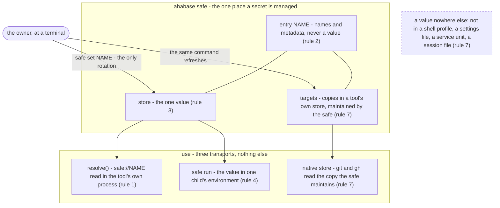

# ahabase Safe Blueprint

> The safe: one interface for secrets with pluggable stores, references instead of values in configuration, and resolution only into the process that needs a value.

**Implements:** [ontology-safe-value-blueprint](ontology-safe-value-blueprint), [ontology-reference-blueprint](ontology-reference-blueprint), [ontology-store-blueprint](ontology-store-blueprint), [ontology-manifest-blueprint](ontology-manifest-blueprint), [ontology-shadow-run-blueprint](ontology-shadow-run-blueprint), [ontology-rotation-blueprint](ontology-rotation-blueprint) - within [implementation-ahabase-architecture-blueprint](implementation-ahabase-architecture-blueprint)
**Story:** [AHA-0002](AHA-0002)
**Code:** safe, cli_safe

## Overview

Secrets of an instance (tokens, API keys, passwords) must stay with their owner and out of files, outputs and LLM context. The safe is the open package's service for them: every door and plugin asks it for a value by name, and the value comes from the user's own store. The code is open and verifiable; the values are Vault-held (Trust Zones) and never leave the user's store except into the one process that needs them.

The mechanism is built before anything is switched: Human decision 2026-10-24 - changing how the instance's secrets are stored or used is extremely risky and happens only with proven end-to-end function, a known impact on every consumer and a tested rotation.

## Architecture

The ruled shape (Human ruling 2026-10-30, rule 7) in one picture - every element is a rule of this blueprint, nothing more:



One entry per secret; one value, in the safe's store; every further copy a registered target the safe refreshes; three transports at use and no fourth; environment variables are transport, never storage.

## Rules

1. **References, not values** - configuration holds `safe://NAME`; `resolve()` turns a reference into its value and passes any other value through unchanged, so consumers can switch one setting at a time.
2. **Manifest without values** - `<workspace>/_config/safe.json` (or `AHABASE_SAFE_MANIFEST`) lists per name: store, store key, purpose, owner, scope, created, expires, last rotated; it never holds a value. Written through a unique temporary file created with mode 600 (`mkstemp`), flushed to disk and renamed over the manifest; every read-modify-write (`set`, `delete`) holds an exclusive lock (`<manifest>.lock`, through the `filelock` library - flock on POSIX, msvcrt on Windows; [implementation-ahabase-safe-windows-blueprint](implementation-ahabase-safe-windows-blueprint)), so concurrent writers lose no entry and leave no store item without its entry.
3. **Stores** - `keyring` (the OS store through the `keyring` library: macOS Keychain, Secret Service, Windows Credential Manager; the default), `env` (read-only environment variables, for CI), `memory` (tests only - the CLI does not offer it, a value that dies with the process would leave a dangling entry). A store offers `get`, `set`, `delete`, `exists`; more stores (a password manager, HashiCorp Vault or OpenBao) plug in behind the same protocol later.
4. **Process-scoped resolution, to bound consumers only** - `ahabase safe run --env VAR=safe://NAME [--keep VAR] -- COMMAND` puts values only into the child's environment; the parent prints none. Before any value is read, COMMAND must be a consumer bound to NAME (`ahabase safe bind NAME /absolute/path [--prefix ARG] [--allow OPTION]`): matched by the bound absolute path, its real target inside the package root recorded at binding (so a package manager's upgrade keeps it valid), its arguments starting with the bound prefix, no redirecting option (`--profiles-dir`, `--config`, `--host`, `--target` and similar) unless allowed. Shells, interpreters, wrappers and general-purpose network tools cannot be bound. The child receives a working base (paths, user, locale, time zone, terminal, proxy and certificate settings), the kept variables and the named values - no other exported value; it is executed as an argument list, never through a shell. A kept variable (`--keep VAR`) passes only when the binding names it (`bind ... --keep VAR`); `run` without a value to resolve refuses. Outside a package manager's keg the bound file is pinned by its digest, so a changed file needs rebinding (`doctor` reports it first). With an override variable (`AHABASE_SAFE_MANIFEST`, `AHABASE_HOME`) set, `run` needs the owner's confirmation, unless the owner trusted that location once (`ahabase safe trust-location`) - the way for services and CI jobs with their own workspace. `bind`, `unbind`, `delete`, `get --reveal`, `compare` and `trust-location` are the owner's steps at a terminal; `run` needs none. Every refusal names the command that proceeds ([implementation-ahabase-safe-threat-model-blueprint](implementation-ahabase-safe-threat-model-blueprint), T2, T9-T12).
5. **No value is printed** - `get` refuses without `--reveal`, and `--reveal` needs the owner at a terminal typing the name (a pseudo-terminal passes the check - against an agent, the agent guard is the control); error messages name the secret, never its value, and never echo an argument (a mistyped `--env` may be a raw value; a target KIND is a registry key, never a value, and may be named); `set` reads the value from a hidden prompt or stdin, never from an argument (shell history, process lists).
6. **Health** - `ahabase doctor` checks the safe: every manifest entry present in its store, expiry within 14 days and past expiry reported, the OS store usable when an entry needs it. Presence is tested by reading the value into the doctor process (the `keyring` library offers no existence query); it is never printed. The check name `safe` is the package's: a plugin can neither take nor replace it.
7. **Rotation** - setting an existing name again records the day as its last rotation; a rotation procedure per consumer is written and tested before any real secret is switched. **The safe is the one place a secret is managed** (Human ruling 2026-10-30): every secret has exactly one entry, and every place its value lives is either the safe's own store or a **target** of that entry - a named copy in a tool's own store (a git credential helper's keychain item, a CLI's own login) which the safe writes and refreshes when the value is set, so rotation happens only in the safe: one command rewrites the reachable targets and names the ones a person must refresh by hand. A write is proven by reading the destination back and comparing it with the value written - in-process, its digest in constant time, never printed; presence alone can be a stale copy (git accepts a value with no credential helper configured and writes nothing, exit 0, and a destination holding the previous value answers present). A target the rotation could not reach is never silent - `set` names it and exits nonzero, and `ahabase safe refresh NAME` rewrites the targets from the stored value once its cause is fixed. No unregistered copy exists. A `git-credential` target may instead be declared **scope-only** (`target add ... --no-copy`, the spec field `"copy": false` - the one structured field of a target, every other is a string): it grants only the helper's host scope, nothing is written for it on rotation (the report says `scope target LABEL - no copy is maintained`, never a fake "refreshed"), the health check is silent for it (no copy exists to be missing), and `target remove` matches it with or without the flag. One target has one custody mode: re-declaring an existing target with (or without) the flag replaces the stored spec (`target ... converted to scope only`, naming the leftover copy honestly - a copy already written in the tool's store, if any, stays until removed by hand), so the two modes never coexist and one rotation never names the same target as both refreshed and scope-only. The helper still answers for a scope-only host - it reads the safe's store value, not a copy - the honest declaration of the pure call-model, in which no tool store holds the value at all. The flag is refused on a `gh-login` target: a gh login is a copy by definition, with no scope role to declare. Environment variables are transport, never storage: no value in a shell profile, a settings file, a service unit or a session file - `run` puts a value into one child process, and that is the only environment it ever inhabits.
8. **Comparison without disclosure** - `ahabase safe compare NAME --env VAR | --file PATH | --git-remote REPO` tells whether the safe holds the same value as the source a consumer reads today (the shadow run before a switch). It compares sha256 digests in constant time and prints only `NAME: same` or `NAME: different` - never a value and never a fingerprint (a fingerprint of a short password can be guessed offline). A file is compared by its content without the trailing line ending only (a leading space is part of the value - a false "same" is the worst outcome of a shadow run); a git remote by the password part of its raw `remote.origin.url`, percent-decoded - not `remote get-url`, which applies `insteadOf` rewrites that may carry another token. Neither stdout nor stderr carries a value: git's output is captured and dropped, errors name the secret only. Exit 0 same, 1 different, 2 when either side is missing or not exactly one source is given. Comparing answers equality for any candidate, so it is the owner's step: a terminal and a confirmation are required, and more than five comparisons of one name within a minute are refused.
9. **Isolation of tests** - the suite points `HOME` at a temporary directory (the workspace and the manifest follow from it, as in production; the override variables are cleared, since the safe guards them) and installs a guard keyring backend that fails any test reaching the real OS store.
10. **Never committable** - the manifest is the target map; writing it inside a git working tree is refused unless that tree ignores it (a home directory kept as a dotfiles repository stays usable).

## Known limits

- **macOS OS store** - any program run by the same Python interpreter can read the items it created without a prompt; per-item access control in Keychain Access narrows it. An agent able to run Python in the user's account can therefore reach a value; the Claude Code permission rules and sandbox must deny that path (a later step).
- **Environment of a child** - other processes of the same user can read a process's environment on some systems; `run` limits exposure in time, not against a local attacker.
- **The manifest is readable** - by design (names and metadata only); it tells which secrets exist.
- **Locking and names are portable** - the manifest lock goes through `filelock` (POSIX `flock`, Windows `msvcrt`) and the module imports on every OS ([implementation-ahabase-safe-windows-blueprint](implementation-ahabase-safe-windows-blueprint)); the not-bindable names match with the OS's exec suffix stripped (`python.exe` -> `python`, `.bat` and `.cmd` included) and `cmd` is in the set, so the Windows interpreters are refused like the POSIX ones.
- **A damaged manifest is refused by name** - unreadable or malformed JSON stops every command with the manifest's path and the way through (move it aside, set the entries again); unknown entry fields are kept aside in `extra`, so a newer version's manifest does not break an older one.
- **Processes without a login session** - the OS store is reliably open in the user's logged-in session; a service started by launchd or systemd, a cron job or an ssh session may find it locked. Every non-interactive consumer is shadow-run in its own context (the service, not a terminal); where the store cannot serve it, the documented exception is a file with mode 600 named in the manifest (store `file`, a later store), never a value in a unit file.
- **Loss of the OS store** (a new machine, a reset keychain) - values are not backed up (a backup is one more copy); recovery is rotation: the manifest names every secret, its purpose and owner, so each is issued anew at its provider and set again.
- **Expiry is only seen when checked** - `ahabase doctor` reports expiry within 14 days; a session-start hook runs the safe check so an expiring token is announced, not discovered by a failing workflow.

## Consumers by kind

| Kind | How it reads the value | Through the safe |
|---|---|---|
| A tool with its own configuration | a value in its config file | the config holds `safe://NAME`; the tool calls `resolve()` (a plain value passes through, so a tool switches one setting at a time) |
| A program reading an environment variable (dbt `env_var()`, database clients, API tools) | a variable exported by the shell profile | `ahabase safe run --env VAR=safe://NAME -- PROGRAM`, or a small wrapper or shell function with the same name; the profile no longer exports the value |
| git over https | a token in the remote URL or an `insteadOf` rewrite | a remote URL without credential; git asks `ahabase safe credential`, the safe's own read-only helper over the store (AHA-0019): git sends its request, the safe answers the value of the entry whose `git-credential` target names the host - no resting copy in any third-party helper. A third-party helper (Git Credential Manager, the OS keychain helper) stays the alternative: its item a target of the secret's entry, written and refreshed by the safe on rotation (rule 7) - the call-model's helper and the custody-model's target are the two designed routes (decided per model in [implementation-ahabase-safe-integration-blueprint](implementation-ahabase-safe-integration-blueprint)). A scope-only `git-credential` target (`--no-copy`, AHA-0020) is the call-model's own declaration form: it grants the helper's host scope while the safe maintains no copy - the same entry can hold both routes side by side |
| git over ssh | a key file, optionally with a passphrase in the OS store | unchanged: a key is not a token; it stays with ssh-agent |
| CI | secrets of the CI provider | unchanged: the `env` store reads them read-only |

## Later steps (each with the Human's consent)

1. Inventory of every consumer of every secret of the instance, end to end.
2. Shadow run: resolve through the safe next to the current path and compare, without using it.
3. A rotation procedure, tested on a non-critical token first; a rollback for every step.
4. Switch one consumer at a time, each with a control run before and after.
5. Agent boundary: permission rules, sandbox and hooks for the stores' locations - in place before the first token with a wide reach (a git hosting token) moves, since an agent able to run the same interpreter could otherwise read it.
6. The safe check at session start (expiry and missing entries announced early).

## Structure

`src/ahabase/safe.py` - the stores (`MemoryStore`, `EnvStore`, `KeyringStore`), the manifest `Entry`, the target kinds (`GitCredentialTarget` through `git credential approve`/`fill`, `GhLoginTarget` through `gh auth login --with-token`; the scope-only variant is the spec field `"copy": false`, honored before the kind's write - nothing is refreshed for it), `Safe` (`set`, `get`, `delete`, `resolve`, `health`, `refresh`, `target_add`, `target_remove`, `credential` - the read-only answer for git's helper protocol, host-scoped by the entry's `git-credential` target) and `parse_credential_request` (git's key=value request, a `url` line split, the host lowercased); `src/ahabase/cli_safe.py` - the `ahabase safe` commands and the doctor check `health()`; `tests/conftest.py` - isolation and the guard keyring; `tests/test_safe.py` - the contract on fictional secrets; `tests/test_safe_git_helper.py` - the helper protocol on fictional secrets (answer, no-answer, username selection, store/erase fail-soft, a real `git credential fill`). The `safe` command name is reserved for the package (a plugin cannot take it).

## Template

```
ahabase safe set NAME [--store keyring] [--purpose ...] [--owner ...] [--scope ...] [--expires YYYY-MM-DD]
ahabase safe list
ahabase safe target add NAME KIND [SPEC ...] [--no-copy]   # git-credential HOST ACCOUNT [--no-copy: helper scope only, no copy] | gh-login [HOSTNAME]
ahabase safe target remove NAME KIND [SPEC ...]
ahabase safe refresh NAME                          # rewrite NAME's targets from the stored value
ahabase safe bind NAME /absolute/path/to/consumer [--prefix ARG ...] [--allow OPTION ...] [--keep VAR ...]
ahabase safe trust-location
ahabase safe unbind NAME /absolute/path/to/consumer
ahabase safe run --env VAR=safe://NAME [--env ...] [--keep VAR ...] -- COMMAND [ARGS]
ahabase safe compare NAME (--env VAR | --file PATH | --git-remote REPO)
ahabase safe credential VERB                     # git's helper protocol on stdin: get | store | erase | capability
ahabase safe get NAME --reveal
ahabase safe delete NAME
```

## Example

```
$ printf '%s' "$NEW_TOKEN" | ahabase safe set jira-api --purpose "issue tracker" --expires 2027-01-31
stored jira-api in keyring (reference: safe://jira-api)
$ ahabase safe compare jira-api --env JIRA_TOKEN
compare 'jira-api' with its current source? [Y/n]:
jira-api: same
$ ahabase safe run --env JIRA_TOKEN=safe://jira-api -- jira-tool search "project = X"
Error: '/usr/local/bin/jira-tool' is not a bound consumer of 'jira-api' - nothing resolved; if it should receive it, its owner runs: ahabase safe bind jira-api /usr/local/bin/jira-tool
$ ahabase safe bind jira-api /usr/local/bin/jira-tool --prefix search
type the name 'jira-api' to bind: jira-api
bound /usr/local/bin/jira-tool to jira-api (stays valid inside /usr/local/bin)
$ ahabase safe run --env JIRA_TOKEN=safe://jira-api -- jira-tool search "project = X"
$ ahabase safe get jira-api
Error: refusing to print a secret without --reveal; ...
$ printf 'protocol=https\nhost=git.example.com\n\n' | ahabase safe credential get
username=42
password=...the value, on the helper's stdout pipe to git only...
```

## Related

- [implementation-ahabase-architecture-blueprint](implementation-ahabase-architecture-blueprint) - where the safe sits
- [00-ahabase-ontology-index](00-ahabase-ontology-index) - the concepts of trust and boundaries this blueprint implements
- [implementation-ahabase-safe-integration-blueprint](implementation-ahabase-safe-integration-blueprint) - which existing tool each further part integrates
- [implementation-ahabase-safe-threat-model-blueprint](implementation-ahabase-safe-threat-model-blueprint) - assets, attackers, threats, controls and residual risk
- [AHA-0002](AHA-0002) - the story
- [AHA-0003](AHA-0003) - compare, the model gaps, consumers by kind
- [safe-first-public-capability](safe-first-public-capability) - where the safe goes next
