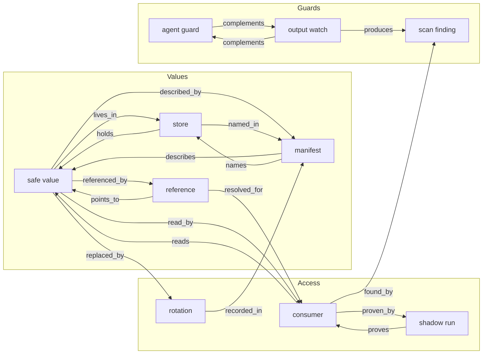

# ahabase-safe Ontology

> The safe's concepts: a value that grants access never sits in a document or a repository - it lives in the user's own store, and only the one process that needs it reads it.

**Type:** Ontology Index
**Status:** defined - moved from the Epic's ontology to this subepic (2026-10-31, [AHA-0018](AHA-0018))
**Scope:** ahabase-safe

## Purpose

This index carries the vocabulary of one capability: the safe. The Epic's ontology keeps the structure that spans capabilities - the Boundary the safe protects and the Trust Zone its content travels in ([00-ahabase-ontology-index](00-ahabase-ontology-index)); how the safe itself works is described here. A concept enters this ontology only when it is robust, minimal and needed by already-agreed implementation, the same criterion the Epic's ontology applies.

## Taxonomy

### Position

- **extends:** [00-ahabase-ontology-index](00-ahabase-ontology-index) - the Epic's architecture (Boundary, Trust Zone) that the safe serves
- **scope:** how the safe works - the one capability this subepic owns

### Facets

| Facet | Values | Purpose |
|-------|--------|---------|
| Values | Safe Value, Reference, Store, Manifest | what is protected and where it lives |
| Access | Consumer, Shadow Run, Rotation | who reads a value and how it changes |
| Guards | Agent Guard, Output Watch, Scan Finding | keeping values away from agents and out of output |

### Hierarchy

```
ahabase-safe
├── ontology/          → this index and the ten concept blueprints
├── implementation/    → implementation-ahabase-safe-blueprint
└── story/             → AHABASE-SAFE (the subepic identity)
```

### Entry Points

| Use case | Start here |
|----------|------------|
| How the safe is built | [implementation-ahabase-safe-blueprint](implementation-ahabase-safe-blueprint) |
| One concept in detail | its blueprint under `ontology/` |
| The structure the safe serves | [00-ahabase-ontology-index](00-ahabase-ontology-index) |

## Vocabulary

### Values

- [Safe Value](ontology-safe-value-blueprint) - a value that grants access (a token, a password, a key); Vault-held, never in a document or repository
- [Reference](ontology-reference-blueprint) - `safe://NAME`, what configuration holds instead of a value
- [Store](ontology-store-blueprint) - where a secret's value lives, the user's own
- [Manifest](ontology-manifest-blueprint) - the description of every secret, without values

### Access

- [Consumer](ontology-consumer-blueprint) - a program or process that reads a secret
- [Shadow Run](ontology-shadow-run-blueprint) - the proof that a consumer gets the same value through the safe, before it switches
- [Rotation](ontology-rotation-blueprint) - replacing a secret's value and revoking the old one

### Guards

- [Agent Guard](ontology-agent-guard-blueprint) - keeps an AI agent from commands and places that show a value
- [Output Watch](ontology-output-watch-blueprint) - catches a value that slips into output
- [Scan Finding](ontology-scan-finding-blueprint) - a place where a readable secret still lies, by name and place only

## Relations

- A [Safe Value](ontology-safe-value-blueprint) lives in a [Store](ontology-store-blueprint), configuration holds a [Reference](ontology-reference-blueprint), and the [Manifest](ontology-manifest-blueprint) describes it without the value.
- A [Consumer](ontology-consumer-blueprint) reads a secret; it moves to a reference only after a [Shadow Run](ontology-shadow-run-blueprint); a [Rotation](ontology-rotation-blueprint) replaces the value afterwards.
- An [Agent Guard](ontology-agent-guard-blueprint) keeps an agent from commands that show a value; an [Output Watch](ontology-output-watch-blueprint) catches a value that slips into output; a [Scan Finding](ontology-scan-finding-blueprint) names where a readable value still lies.
- The safe serves the Epic-level structure: the Boundary places what it protects and the Trust Zone bounds how far it travels ([00-ahabase-ontology-index](00-ahabase-ontology-index)).

## Constraints

- A [Safe Value](ontology-safe-value-blueprint) MUST NOT appear in a document or repository: documents hold a [Reference](ontology-reference-blueprint), the value lives in a [Store](ontology-store-blueprint), and the [Manifest](ontology-manifest-blueprint) describes it without the value.
- A [Consumer](ontology-consumer-blueprint) MUST be bound before it reads a secret, and switches to a reference only after a [Shadow Run](ontology-shadow-run-blueprint) proves the same value arrives.
- A value MUST be revealed only to a person at an interactive terminal: the [Agent Guard](ontology-agent-guard-blueprint) keeps it out of agent reach and the [Output Watch](ontology-output-watch-blueprint) catches it when it slips into output.

## Ontology map

Generated by `ahabase ontology graph` - never edit by hand.

<!-- ontology-map:begin -->

<!-- ontology-map:end -->

## Related

- [AHABASE-SAFE](AHABASE-SAFE) - the subepic
- [implementation-ahabase-safe-blueprint](implementation-ahabase-safe-blueprint) - the code
- [00-ahabase-ontology-index](00-ahabase-ontology-index) - the Epic's architecture
